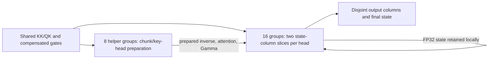

# GDN structural search: current findings

The latest change keeps C=128 and C_inv=16, promotes factored/asynchronous
joining, and adds concurrent token preparation with independent value-column
workers for underfilled H8 shapes. The caller contract and accuracy policy are
unchanged. Earlier experiments below retain their historical checkpoint labels;
none establishes that the search space is exhausted.
[Measurements, numerical metrics and source/library hashes](data/algorithm_search.json).

## Token preparation and value-column parallelism: promoted in `365b105`

**The useful combination is token-parallel preparation plus value-column
parallel recurrence.** Moving preparation by itself did not improve the full
pipeline. With eight heads, two workers per head each retain a disjoint 128×64
FP32 state slice. Sixteen groups perform recurrence, while the remaining eight
prepare future chunks. The recurrence stays ordered in time, but its value
columns are independent: no approximate scan or recurrent-state transfer is
introduced.



K1 helpers cache each KK/QK stripe across grouped value heads, apply gates/beta,
solve 16×16 leaves on vector cores, join on cube cores, and export the factored
inverse. K2 workers project Q/K against their state, form RHS while the cube
waits for/loads the inverse, solve residuals, and update output/state. All cube
products except the original FP16 Q/K × paired-state projection retain native
FP32 operands. The final join is F=−D1*L10; applying F*R0 avoids materializing
F*D0. The normal persistent schedule shares these factored/asynchronous joins.

Dispatch uses **shape only**: H=8, one sequence, at least 1024 tokens, and at
least two chunk/key-head preparation tasks per helper. On this 24-group device,
Hg=1 therefore starts at 2048 tokens; Hg≥2 starts at 1024. Shorter inputs and
other head/batch counts retain local preparation. H12 split workers consume
all 24 groups and leave no helpers; that serialized-preparation experiment did
not win, so it is not retained. There is no gate/beta/correlation threshold.

### Exact promoted binary versus previous production

Ascend910B2, D=C=128, nonzero initial state, ordinary seed-0 benchmark inputs.
Each time is a median of 15 allocation-free device-graph trials × 20 calls,
with FP64 output/state checks before and after replay. Libraries run serially
and alternate order between head configurations. These are fresh paired
measurements, not comparisons against previously saved heatmap medians.

Before: `677c0ee` source, library `dfb01e1…`. After: `365b105`, library
`4dc29f4de899315b167f958138895eeca7f9a71c2c16a5b3e4bff36a50979f1c`. Full hashes and individual timing trials are
in the JSON. This table compares against the kernel installed before this turn;
the [speed heatmap](heatmap.md) separately compares against original `10748eb`.

**H8/Hg2:**

| Tokens | Before µs | After µs | Speedup |
|---:|---:|---:|---:|
| 256 | 83.51 | 81.94 | 1.019× |
| 1,024 | 205.68 | 180.18 | 1.142× |
| 2,048 | 354.52 | 281.89 | 1.258× |
| 4,096 | 685.76 | 520.10 | 1.319× |
| 8,192 | 1257.32 | 967.97 | 1.299× |
| 16,384 | 2558.70 | 1834.33 | 1.395× |
| 32,768 | 4956.42 | 3862.76 | 1.283× |

**4K across head configurations:**

| H/Hg | Before µs | After µs | Speedup |
|---|---:|---:|---:|
| 8/1 | 665.81 | 555.24 | 1.199× |
| 8/2 | 685.76 | 520.10 | 1.319× |
| 8/8 | 693.98 | 517.22 | 1.342× |
| 12/3 | 694.72 | 667.78 | 1.040× |
| 16/4 | 696.09 | 665.36 | 1.046× |
| 24/8 | 721.42 | 697.36 | 1.035× |
| 48/16 | 1423.27 | 1406.47 | 1.012× |

H16/Hg4 at 8K/16K/32K improves only 1.029×/1.026×/1.011×; those shapes use
local preparation. The new parallel work partition benefits underfilled H8
shapes, not all workloads. At T256 the three H8 layouts change by approximately
−2.4% to +1.9% in speedup. This is not a uniform short-sequence win or a general
2×/3× improvement. Different sweeps fluctuate by several percent; all raw medians
are retained rather than selecting only the fastest run.

### What was tried and discarded

Initial complete-pipeline screens at H16/Hg4/T4096, same ordinary input family:

| Schedule | Median total µs | Numerical evidence |
|---|---:|---|
| All token preparation, barrier, then recurrence | 866.6 | 9-case screen passes |
| Preparation streams from spare groups to recurrence | 745.0 | 9-case screen passes |
| Helpers prepare vector leaves; recurrence cube retains joins | 679.4 | 9-case screen passes |
| Same leaf-only schedule plus early RHS release | 684.4 | 9-case screen passes |
| Leaf-only helpers plus 64-token gate panels | 688.8 | 9-case screen passes |

The join-only candidate was roughly 650–670 µs in these experiments. A screen
pass is not full validation. H8 full-inverse streaming without value-column
splitting was about 640 µs at 4K; adding the independent column workers brought
that prototype to about 522 µs, and early RHS release measured about 501–518 µs
in subsequent runs. These separate runs establish the combined candidate's
promise, not a precise isolated estimate of the early-RHS effect. The broad
final tables above are the promoted result.

### Gate rescaling experiment

The [FlashKDA report](https://github.com/MoonshotAI/FlashKDA/blob/master/docs/20260420-flashkda-v1-deep-dive.md)
uses C=16 and a −5 lower bound with **BF16**, whose exponent range differs from
FP16. Its bound is not a justification for clamping our inputs or using FP16
reciprocal gate scaling. Our existing C=128 preparation already computes
Gamma_i=exp(G_end−G_i)*K_i in FP32, and compensated local prefix pairs preserve
small gate differences. There is no division by an underflowed exponential.

I implemented local gate panels of 16 and 64 tokens. Within a panel, retain
the compensated difference G_i−G_j. Between panels, factor at a boundary b:

```
exp(G_i−G_j) = exp(G_i−G_b) * exp(G_b−G_j),  j ≤ b ≤ i
```

For nonpositive gates both factors are ≤1. Invalid rows/future columns remain
masked before exponentiation; the existing positive-gate tests are not clipped.
The 64-token version passed the complete **246-test suite then in use**, including
long weak gates, correlated keys and large-amplitude inputs. Its matched 4K
speedups across H8/12/16/24/48 were only 1.003×, 1.008×, 0.986×, 1.011× and
1.011×. At 256 tokens it regressed about 2–4%. The 16-token version also passed
the nine-case screen but took about 726 µs at H16/4K. Fewer exponentials did
not yield a useful full-pipeline gain. **No gate-panel implementation is retained.**

### Verification, interface and file footprint

The exact promoted binary passes **264 tests in 171.38 seconds**: 178 fixed
numerical cases plus wrapper/checker/benchmark tests. Eighteen new cases cover
H8/Hg1, H8/Hg4 and H8/Hg8 at 1024/2048/2139 tokens, nearly correlated keys,
beta=1, g=−1e-6, amplitude 32 and supplied/absent state. Existing cases cover
32K, zero/tiny/strong gates, beta endpoints and correlated-input stress.
Every output/final-state element must satisfy the unchanged bound
`abs(error) <= 1e-4 + 1e-3*abs(CPU FP64 reference)`, with finite/RMSE checks,
five poisoned-scratch launches, input integrity and output guards. This verifies
the tested regimes; it is not a proof for arbitrary unbounded inputs.

All seven head specializations build in **14.53 seconds**. The quick screen
passes 9/9 in **2.19 seconds** and now benchmarks both H8 and H16 so future
iterations exercise both schedules. The maintained H16 profiling diagnostic
also compiles and passes FP64 checks after adapting its instrumentation to the
shared generic functions. The existing [profile](profile.md) remains explicitly
historical; it is not relabeled as a trace of the new H8 schedule.

Inputs, output/state shapes, dtypes, initial-state semantics, host launch count
and caller allocation sizes are unchanged. K1 caches raw QK before reusing
`A_inv_f32` for prepared per-head inverses. The unused upper-right inverse entry
holds a ready flag; publication follows completed vector exports and cube joins.
An extra initialization barrier precedes the concurrent producer/consumer phase.
The regular path retains its original two phases. C=128 and C_inv=16 remain fixed.

Production has **seven source files, 1,342 physical lines**, versus 1,171 before
this change. No additional production files, user tuning options, numerical
fallbacks or probe kernels are added. Rejected prototypes, generators, builds
and raw logs are removed after saving their measurements here and in the JSON.

## Earlier inverse/chunk search: full-pipeline NPU results

Ascend910B2, D=128, 16 value heads / 4 key heads, T=4096, nonzero initial state.
Times are median device microseconds from 15 graph trials of 20 calls. Ranges
show the two latest measurements in opposite variant order. The nine-case
screen retains exact regular-suite inputs and five poisoned-workspace launches;
it does not replace the complete 246-test suite.

| C | C_inv | A: leaf inversion | J: joining/application | Total µs | Numerical evidence |
|---:|---:|---|---|---:|---|
| 128 | 16 | Forward substitution, vector FP32 | Full inverse, cube FP32 (production) | 697–700 | Full 246 tests pass |
| 128 | 16 | Forward substitution, vector FP32 | Factored final join + asynchronous independent joins | **652–666** | Full 246 tests pass |
| 64 | 16 | Forward substitution, vector FP32 | Factored final join | 835 | 9/9 screen pass |
| 64 | 32 | Forward substitution, vector FP32 | Factored final join | 960 | 9/9 screen pass |
| 128 | 32 | Forward substitution, vector FP32 | Full or factored final join | Not measured | Both 8/9; large nearly-correlated case fails |
| 128 | 32 | Reverse substitution, vector FP32 | Full inverse | 843 | 9/9 screen pass |
| 128 | 32 | Reverse substitution, vector FP32 | Factored final join | 851 | 9/9 screen pass |
| 128 | 64 | Forward substitution, vector FP32 | Factored final join | Not measured | 8/9; large nearly-correlated case fails |
| 256 | 16 | Forward substitution, vector FP32 | Factored final join | 868 | 8/9; large nearly-correlated case fails |
| 256 | 16 | Reverse substitution, vector FP32 | Factored final join | Not measured | Same screen case fails |

The C=256 prototype needs larger scratch allocations, streaming vector panels,
separate Q/K projections and separate output/state products. It also stores
intermediate state/output bases in global memory to fit on chip. Its time is a
result for that concrete schedule, not evidence that every C=256 design is slow.
It was only built/screened for H=8/16. The C=64/128 prototypes retain the existing
allocation sizes. Initial C=64 layout and C=256 capacity bugs were fixed before
these numerical results; failed device executions were never timed.

A separate chunk-worker rotation prototype uses otherwise idle groups but adds
state transfer and readiness polling. It passed 9/9 and took 904 µs at 4K, so this
implementation is rejected.

## What the A experiments establish

The CPU screen covers 1,920 case/configuration combinations: C=64/128/256,
C_inv=8/16/32/64, full/factored joining, eight fixed distributions, and several
leaf algorithms/arithmetic choices. It tests correlated and nearly correlated
keys, beta=1, zero/tiny gates, high-amplitude inputs and FLA input families.
These are sampled matrices, not complete input-domain guarantees.

For L=I-N with strictly lower-triangular N, the inverse is the *finite* polynomial
I+N+...+N^(C_inv-1). None of these models drops powers based on decay.
Horner, Estrin and Paterson–Stockmeyer have **not yet been implemented and
benchmarked as complete NPU pipelines in this sweep**. Band-limited Newton has
now been tested on hardware; see the cube Newton experiment below.

Maximum absolute leaf-inverse error against FP64, with FP32 arithmetic:

| A | C_inv=8 | C_inv=16 | C_inv=32 | C_inv=64 |
|---|---:|---:|---:|---:|
| Forward substitution | 2.53e-08 | 3.31e-08 | 3.31e-08 | 4.34e-08 |
| Horner | 2.53e-08 | 3.31e-08 | 3.31e-08 | 4.34e-08 |
| Estrin / power doubling | 2.78e-06 | 4.48e-04 | 2.00e+01 | 8.59e+10 |
| Paterson–Stockmeyer | 8.94e-07 | 2.24e-04 | 8.88e+00 | 2.77e+10 |
| Band-limited Newton | 2.53e-08 | 3.50e-08 | 3.31e-08 | 4.34e-08 |

- **Forward/reverse substitution:** the best demonstrated choices so far.
  Larger leaves remove cube joins but lengthen vector dependencies. Reversing
  the solve direction changes rounding and rescued the C_inv=32 screen, but was
  slower than C_inv=16. A nine-case pass is not a full accuracy certificate.
- **Horner:** accurate in this CPU screen, but has C_inv−2 dependent dense matrix
  products after forming I+N: 14 at size 16, 30 at size 32. Its intermediate
  magnitude reached 2.33e17 at size 64 even though its final inverse was accurate.
  Thus accurate FP32 results do not establish safety of an FP16 implementation.
- **Estrin and Paterson–Stockmeyer:** fewer matrix stages, but severe cancellation
  on some correlated inputs. Size-16 inverse errors are already about 2e-4–4e-4;
  size-32 errors reach order 10. Their unmodified FP32 forms are poor candidates
  for the full supported numerical regime. This does not rule out stabilized
  or differently preconditioned variants of these methods.
- **Band-limited Newton:** numerically promising in this CPU study. Starting
  with the diagonal and first subdiagonal, apply X←X(2I−LX), then retain the
  diagonal band known to be correct. The band grows 1→3→7→15→31→63. In exact
  arithmetic, if I−LX is zero through band b, its square is zero through band
  2b+1; truncating outside the new band preserves those correct entries. This
  is a structural construction, not a decay threshold. Sampled intermediate
  magnitudes stayed ≤1 and FP32 errors remained near forward substitution.
  It needs 6 dense products at size 16 and 8 at size 32, plus masking and data
  movement. The hardware experiment below finds that the tested cube mapping is
  slower than vector substitution.

Single-FP16-operand polynomial models also fail multiple sampled regimes.
Neither their failure nor the CPU FP32 success substitutes for NPU elementwise
verification.

## What J and C establish

For a two-block unit lower-triangular system, let D0 and D1 be the diagonal-block
inverses and F=−D1 L10. The original schedule forms F D0 and then applies the
full inverse. The factored schedule computes

```
R0 = D0 B0
R1 = D1 B1 + F R0
```

It avoids forming F D0. The successful candidate also overlaps independent
joins and their transfers with explicit pipeline dependencies. Its measured
improvement combines the algorithm and scheduling changes; it is not a pure
J-only ablation. An earlier isolated factored-only screen gave about 674 µs
versus 692 µs for its matched baseline.

The same A=32 forward-substitution failure occurs with both full and factored
J. Changing A to reverse substitution fixes that screen for both joins. Thus
accuracy belongs to the complete (C,C_inv,A,J) combination, not an independent
certificate for either A or J.

C=64 increases the number of recurrent steps/state exchanges; reduced inverse
work did not offset that cost in either measured configuration. C=256 reduces
those exchanges but increases matrix work and forces substantial retiling.
**C=128, C_inv=16 remains the best measured complete configuration.** The modest
factored/asynchronous gain is not the requested breakthrough, and its long-context
gain is smaller and variable; no 2× or 3× new improvement has been demonstrated.

## Cube Newton hardware experiment

Band-limited Newton was implemented and tested as a complete NPU pipeline for C=128
and C_inv=16/32. It uses native FP32 cube products and vector band masks:

```
X = I + first_subdiagonal(N)
L = I - N
repeat until the band covers the leaf:
    E = I - L @ X
    X = mask_to_next_band(X + X @ E)
```

The 16-leaf version performs three Newton iterations; the 32-leaf version
performs four. Masks retain bands 0..3, 0..7, 0..15, and then 0..31. There is
no decay-based power truncation, threshold, or sequential fallback. Both use
factored final joining and overlap independent joins, matching the FP32 search
candidate. The external input/output ABI and all caller allocations are unchanged.
The packed Newton operands fit in the existing 32 KiB per-group solve scratch.

The first implementation incorrectly placed a persistent distance tile in
PTO's reserved [184,192) KiB UB scratch, causing ordinary-input failures.
Moving it below that region fixed the defect. Those broken executions are
excluded from performance and numerical conclusions. Final constants use vector
broadcast/arithmetic rather than a scalar store for every mask element.

H16/Hg4, D=128, nonzero initial state. Each entry is the range of two median
measurements in opposite variant orders; each median uses 15 graph trials of
20 calls. Outputs and final states pass before and after replay. Times are µs.

| Algorithm | T=256 | T=4096 | T=32768 |
|---|---:|---:|---:|
| Production, vector A16 | 82.4–82.5 | 692.5–694.7 | 5348.4–5429.7 |
| Factored/overlapped joins, vector A16 | 78.6–79.2 | 659.1–661.6 | 5327.6–5330.9 |
| Cube Newton A16 | 105.1–105.2 | 1183.0–1191.2 | 9518.5–9619.5 |
| Cube Newton A32 | 109.0–111.2 | 1281.0–1285.7 | 10147.4–10204.5 |

Both final Newton variants pass **all 246 regression tests**, including the
independent FP64 token-recurrence elementwise checks on outputs and final states,
input/guard integrity and five poisoned-workspace launches. The unchanged bound
is `abs(error) <= 1e-4 + 1e-3*abs(reference)`; no RMSE-only acceptance or relaxed
tolerances. Full-suite times were 154.6 s (A16) and 155.6 s (A32); all-seven-head
builds took 12.0 s and 11.2 s. These tests cover the supported test catalog, not
every possible input.

All three candidates also pass a matched nine-case numerical audit. On the
nearly-correlated beta=1, g=-1e-6, amplitude-128 stress case, the worst
error/allowance ratio over output and state is **0.9794** for vector A16,
**0.8823** for Newton A16, and **0.8160** for Newton A32. A ratio above 1 fails.
This gives Newton useful numerical margin on this case, but does not offset
its roughly 1.8–1.9× long-context runtime cost against the faster vector candidate.

This particular cube mapping loses despite logarithmic iteration depth. At
C_inv=16, its eight leaves require 48 small cube matrix multiplies per chunk;
at C_inv=32, four leaves require 32. These are in addition to the remaining
joins. Each iteration also needs two cube-to-vector-to-cube exchanges to form
the residual and mask/update X: six exchanges at size 16, eight at size 32.
Native FP32 accumulator results cannot feed L1 directly on this device, so
these exchanges go through global-memory addresses, usually served by L2.
The mask and update vector work interrupts the vector-side preparation pipeline.
Fewer sequential mathematical steps therefore do not imply a faster pipeline.

Fresh H16/T4096 hardware counters confirm that arithmetic is a small part of
the extra latency. Values below are active-group medians in µs; engine times
and waits overlap and must not be added as a wall-time breakdown.

| Counter | Vector A16 candidate | Newton A16 | Newton A32 |
|---|---:|---:|---:|
| Cube arithmetic | 157.9 | 182.0 | 184.2 |
| Cube MTE1 | 78.8 | 129.1 | 121.9 |
| Cube MTE2 | 161.2 | 228.1 | 225.6 |
| Cube waits for Newton vector exchanges | — | 373.2 | 431.7 |
| Vector waits for Newton cube products | — | 248.8 | 322.3 |

Cube-side L2 read-hit rates are 98.98%, 99.02% and 99.15%, respectively.
The evidence points to instruction/transfer dependencies and repeated core
handshakes; it does not establish saturated HBM bandwidth.

These results reject this concrete round-trip-heavy mapping, not every stabilized
Newton implementation. A competitive version would need to remove most of the
intermediate exchanges or combine substantially more independent work per cube
instruction. Changing leaf size alone did not solve the problem. Production is
unchanged; this is a stable but slower experimental result, not a speed advance.

The existing JSON evidence retains build/source/library hashes, full-suite
results, checked timing trials, numerical metrics and hardware counter summaries.
Rejected Newton source patches, prototypes, debug scripts, binaries and raw
profiler dumps were removed after recording these results.

## HF32 precision/runtime tradeoff

This is a separate arithmetic experiment on the factored/asynchronous C=128,
C_inv=16 schedule. It enables the hardware's HF32 mode for all FP32 cube
products; tensors still use the original public dtypes. The [Ascend C documentation](https://asc.gitcode.com/api/SIMD-API/c_api/cube_compute/mmad_compute_key_features/HF32.html)
describes operand rounding and increased matrix arithmetic throughput. That is
not a guarantee of a corresponding full-kernel speedup.

Fresh matching inputs and CPU FP64 token recurrence; 13 selected numerical cases,
five poisoned launches each, plus checked timing replays. Both FP32 variants pass
13/13; HF32 passes 3/13. All remain finite and preserve inputs/guards. This is
selected coverage, not a full HF32 regression audit.

| T | Production µs | Matched FP32 candidate µs | HF32 µs |
|---:|---:|---:|---:|
| 256 | 82.1–84.3 | 79.6–80.6 | 76.6–78.1 |
| 4096 | 697.2–700.2 | 651.6–665.9 | 620.6–624.0 |
| 32768 | 5371.0–5456.1 | 5154.9–5363.4 | 4948.2–4980.7 |

Keeping rtol=1e-3, the following absolute floors would be necessary to accept
both output and final state for each HF32 case (current atol is 1e-4):

| Regime | Required atol | HF32 max output abs error | HF32 max state abs error |
|---|---:|---:|---:|
| Ordinary weak gates | 0.000346494 | 0.000811651 | 0.000764642 |
| Identical keys, beta=1, no decay | 0.00394666 | 0.00106033 | 0.00402832 |
| Identical keys, beta=1, g=−1e-7, 32K | 0.00295667 | 0.00233753 | 0.00390625 |
| Nearly correlated, beta=1, g=−1e-6, amplitude 1 | 0.00234357 | 0.00290486 | 0.00192744 |
| Same regime, amplitude 32 | 0.0749942 | 0.0929554 | 0.0616779 |
| Same regime, amplitude 128 | 0.299977 | 0.371822 | 0.246712 |

Maximum error alone can hide damage near zero: in the amplitude-128 case,
production's maximum output error is 0.249755 (FP16 output rounding), versus
HF32's 0.371822. But at a reference value of −0.00812336, HF32 has absolute error
0.124456. HF32 violates the elementwise bound at 176,009 of 1,049,600 output
elements in this case (~16.8%), despite relative RMSE≈3.47e-4 passing the RMSE
criterion. Accepting all 13 sampled cases at fixed rtol would require atol≈0.30.
That would not establish acceptance of the full suite or model-quality equivalence.
No tolerances have been changed and HF32 has not been promoted.

## Reproduction and next work

The committed fast build/verification entry point is:

```bash
bash scripts/gdn_mega_docker.sh bash scripts/check_gdn_mega.sh --quick
bash scripts/gdn_mega_docker.sh bash scripts/check_gdn_mega.sh
```

`--source` and `--output` build isolated source snapshots. Rejected experimental
sources, build outputs and raw runs were removed at the user's request. Historical
paths inside the evidence JSON identify provenance; they are not live dependencies.
Production still has seven sources and its unchanged allocation contract.
Its two internal schedules share the same arithmetic and helpers.

The factored/overlapped-join improvement is now part of production, together
with the token-preparation/value-column schedule. Its old isolated library is
no longer needed. The historical patch remains under `retained_improvement`
in the JSON, anchored to its recorded **pre-promotion** source hashes; it is
not a patch to apply to today's source.

The native FP32 cube Newton mapping has now been tested, including masking,
transfers and the surrounding pipeline. Further work on this family would need
to remove its repeated cube/vector exchanges. More pipelined C=256 schedules
and other joining algorithms remain open; this sweep does not exhaust the
search space.
