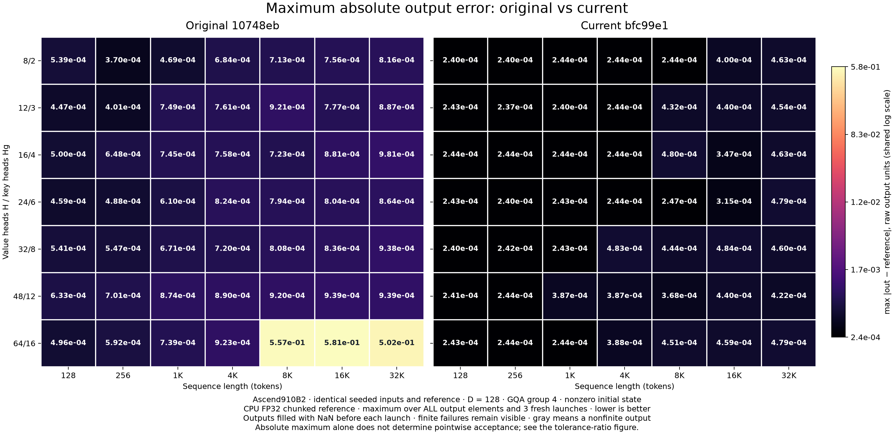
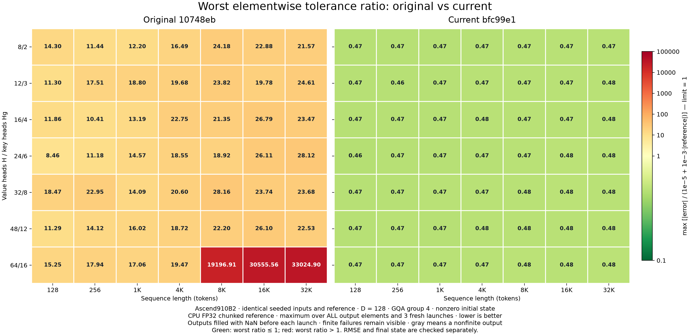

# Original versus current GDN output error

Fresh measurements on 2026-10-26, original `10748eb` versus current stable
`bfc99e1`. Both implementations receive byte-identical inputs and reference
results. These are accuracy measurements, separate from the historical latency
baseline in [the speedup heatmap](heatmap.md).



## Full-grid results

**Current passes 49/49 shapes; original passes 0/49** under the same strict
output and final-state policy. All observed outputs are finite; the large
original failures are not hidden behind a nonfinite marker.

| Measurement across 49 shapes | Original | Current |
|---|---:|---:|
| Maximum absolute output error, range across cells | 3.7008e-4–5.8078e-1 | 2.3705e-4–4.8440e-4 |
| Worst per-element tolerance ratio, range across cells | 8.456–33024.896 | 0.459–0.479 |
| Shapes with different output/state bits across repeats | 3 | 0 |
| Shapes passing all output and final-state checks | 0/49 | 49/49 |

Outside the three repeat-dependent H64 failures described below, original maximum
absolute errors range from 3.7008e-4 to 9.8100e-4. Current's global maximum equals
the FP16 rounding lower bound in **47/49 shapes**. In the other two it is at most
**0.170% above that lower bound**. This describes a maximum statistic, not proof
that all current output values are correctly rounded. Both implementations leave
their inputs unchanged in every shape.

## Repeat-dependent failures in the original

The fresh original-kernel runs also expose large finite output errors at H64:
maxima 0.55745 at 8K, 0.58078 at 16K and 0.50206 at 32K. At 8K, the first
launch has max error 8.37e-4, while subsequent launches reach 0.55745 on identical
inputs. These errors are not explained by ordinary FP16 rounding; the underlying
execution issue has not been diagnosed by this measurement. They remain in the
plots and JSON, including each repeat, rather than being replaced by the first
launch or a historical run. This is additional evidence that historical timings
are not proof of numerical acceptance.

## Why the current kernel is more accurate

The main Q/K/V, state and output tensors remain FP16 at the interface, but internal arithmetic
changed substantially:

1. The original rounds several intermediate matrices, residuals and state
   projections to single FP16 values. The current implementation keeps Gram
   matrices, the inverse, residual solve and output/state products in FP32.
   FP32 accumulation cannot recover information already rounded out of operands.
2. The authoritative recurrent state stays in FP32. For the fast Q/K projections,
   it is represented as `high = fp16(state)` and
   `low = fp16(state - fp32(high))`; both products accumulate into FP32.
   The second component preserves much of the rounding residual that one FP16
   state operand would lose.
3. Stable 16×16 triangular substitution and FP32 block joins replace inverse
   powers. This avoids huge cancelling intermediates on strongly coupled inputs.
   Gate prefixes use compensated FP32 arithmetic, and `exp(G_i-G_j)` is retained.
   Difficult strongly coupled heads additionally have a compensated FP32 token
   recurrence fallback. This ordinary Gaussian grid is not an ablation measuring
   the contribution of each change or the performance of that fallback.

FP16 output rounding remains unavoidable. The data records the lower bound
`max(abs(fp16(reference) - reference))` for each shape. Matching this global
maximum does **not** establish that every output element is correctly rounded.

## Absolute error and the actual acceptance bound

The required per-element bound is **mixed absolute/relative**:

```text
abs(out[i] - reference[i]) <= 1e-5 + 1e-3 * abs(reference[i])
```

It is not a uniform maximum absolute error of `1e-5`. Errors near zero receive a
much smaller allowance than errors on large outputs. Therefore the location of
the largest absolute error need not be the worst violation. This companion plot
shows the maximum of `abs(error) / allowed_error`; every element meets the bound
exactly when that maximum is at most 1. Finiteness, relative RMSE < 0.005 and final
state checks are additional requirements.



## Matched H16/Hg4 results

Raw output units; maxima across all elements and three launches.

| Tokens | Original max abs | Current max abs | Original worst tolerance ratio | Current worst tolerance ratio | Original violating elements |
|---:|---:|---:|---:|---:|---:|
| 128 | 4.999626e-04 | 2.440507e-04 | 11.855 | 0.468 | 5,362 |
| 256 | 6.481899e-04 | 2.440794e-04 | 10.409 | 0.468 | 9,835 |
| 1024 | 7.447531e-04 | 2.441247e-04 | 13.191 | 0.465 | 40,079 |
| 4096 | 7.584202e-04 | 2.438953e-04 | 22.752 | 0.478 | 153,009 |
| 8192 | 7.233129e-04 | 4.797631e-04 | 21.355 | 0.472 | 312,594 |
| 16384 | 8.806466e-04 | 3.466844e-04 | 26.789 | 0.474 | 626,636 |
| 32768 | 9.809977e-04 | 4.633664e-04 | 23.466 | 0.476 | 1,255,473 |

The current implementation has zero violating output elements at every shape in
this table. Final-state results and all repeat metrics are retained in the JSON.

## Measurement contract

Ascend910B2; H=8/12/16/24/32/48/64; key heads H/4; D=128; chunk size 128;
T=128/256/1024/4096/8192/16384/32768. Seed 0, normalized Gaussian Q/K, ordinary
log-sigmoid gates at scale 1, and nonzero FP16 Gaussian initial state scaled by
0.1. These shapes match the latency grid. They do not cover all FLA-derived input
families or establish accuracy for arbitrary unbounded inputs.

Each cell uses the maximum across **all output elements and three launches**.
The output and final state are filled with NaN before each launch. Caller scratch
initialization is preserved for both implementations. No outlier removal,
subsampling, fitted scaling, or failed-cell exclusion is used. Finite failures
remain colored; nonfinite outputs are explicitly labeled NaN/Inf. Statistics are
reused only when every output and final-state bit is identical to the previous
launch. Inputs are checked for modification after the launches.

Values are in **raw, unscaled kernel output units**. The caller's usual
`1/sqrt(128)` output scaling would divide these maximum absolute errors by
sqrt(128); it is not applied to either implementation in this comparison.
The full grid uses the CPU FP32 chunked reference, converted to raw units in
FP64. Separate selected-shape checks use the independent CPU FP64 token
recurrence. The full grid must not be described as an FP64-oracle sweep.

## Independent FP64 checks

H16/Hg4, the same seeded inputs and three poisoned-output launches. Both current
shapes pass every output/final-state criterion against the independent FP64 token
recurrence; both original shapes fail. The main-grid conclusion is unchanged.

| Tokens | Original max abs vs FP64 | Current max abs vs FP64 | FP32/FP64 reference max output discrepancy | FP32/FP64 reference max state discrepancy |
|---:|---:|---:|---:|---:|
| 128 | 5.000370e-04 | 2.441298e-04 | 1.531161e-06 | 1.259506e-06 |
| 4096 | 7.587292e-04 | 2.439079e-04 | 3.619718e-06 | 2.329341e-06 |

These reference discrepancies are measured over every element in each selected
shape. Only these two shapes use the independent FP64 oracle in this report;
the 49-cell heatmaps use the CPU FP32 reference.

## Files and reproduction

- [Maximum absolute error PNG](error_heatmap_max_abs.png) / [SVG](error_heatmap_max_abs.svg)
- [Tolerance-ratio PNG](error_heatmap_tolerance.png) / [SVG](error_heatmap_tolerance.svg)
- [Complete measurements, repeats and fingerprints](error_heatmap.json) / [compact CSV](error_heatmap.csv)
- [Independent FP64 crosschecks](error_heatmap_fp64_checks.json)
- [Validation log](error_heatmap_validation.txt)

With the frozen original library in `benchmark_data/gdn_mega/baseline_lib` and
the current library in `build/lib`, run inside the prepared CANN container:

```bash
source /usr/local/Ascend/cann/set_env.sh
python benchmarking/gdn_mega_errors.py --output docs/gdn_mega/error_heatmap.json
python benchmarking/plot_gdn_mega_errors.py docs/gdn_mega/error_heatmap.json
python benchmarking/gdn_mega_errors.py --heads 16 --lengths 128 4096 \
  --reference recurrent-fp64 --output docs/gdn_mega/error_heatmap_fp64_checks.json
```

The measurement script checks the actual loaded library hash in isolated
processes, and input/reference/policy/environment equality between implementations.
The plotter rejects missing cells, mismatched comparisons, hidden nonfinite
repeats and summaries that understate the observed maximum. No production kernel,
interface, allocation size, or tolerance changed for this report.
