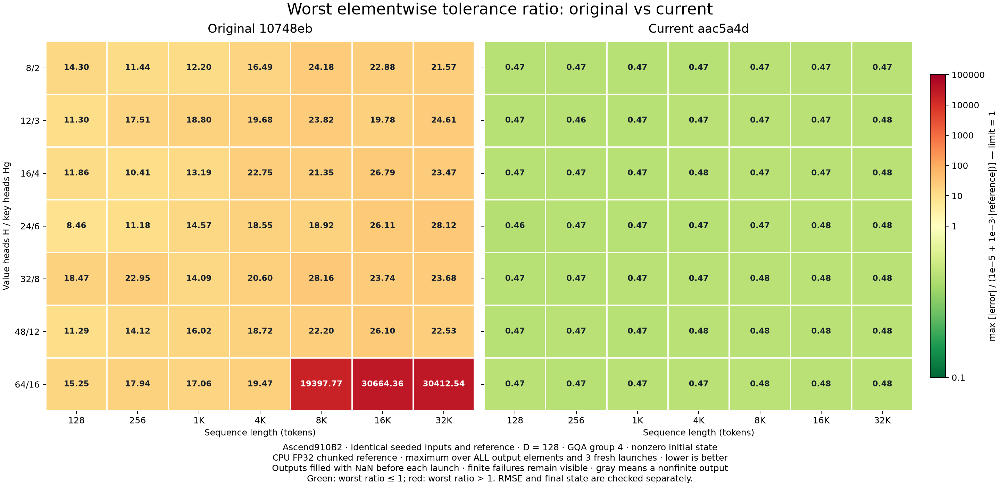

# GDN absolute-error heatmaps

Measurements dated 2026-10-26; original **10748eb**,
current **aac5a4d**. Both receive identical inputs and reference
results. [Overview](README.md) · [Latency heatmap](heatmap.md).


**Current passes 49/49 shapes; original passes
0/49**, checking both output and final state.
Finite failures remain visible on the shared scale; gray marks NaN/Inf.

## Elementwise acceptance

```text
abs(actual[i] - reference[i]) <= 1e-5 + 1e-3 * abs(reference[i])
```

This is a mixed absolute/relative bound, **not** a uniform maximum absolute error
of 1e-5. The ratio below divides each element's error by its allowance; a maximum
ratio ≤ 1 means every element satisfies that bound. Finiteness, relative RMSE < 0.005
and final-state checks are additional requirements. No outliers are discarded.



## H16/Hg4, raw output units

| Tokens | Original max abs | Current max abs | Original worst ratio | Current worst ratio |
|---:|---:|---:|---:|---:|
| 128 | 5.000e-04 | 2.441e-04 | 11.855 | 0.468 |
| 256 | 6.482e-04 | 2.441e-04 | 10.409 | 0.468 |
| 1024 | 7.448e-04 | 2.441e-04 | 13.191 | 0.465 |
| 4096 | 7.584e-04 | 2.439e-04 | 22.752 | 0.478 |
| 8192 | 7.233e-04 | 4.798e-04 | 21.355 | 0.472 |
| 16384 | 8.806e-04 | 3.467e-04 | 26.789 | 0.474 |
| 32768 | 9.810e-04 | 4.634e-04 | 23.466 | 0.476 |

## Measurement contract

CPU FP32 chunked reference; seed 0; D128; GQA group 4;
nonzero initial state; normalized Gaussian Q/K, gate scale1.0.
Maxima include **every output element and all 3 fresh launches**.
Outputs and final state are filled with NaN before each launch. Caller scratch
initialization is preserved. Input/reference fingerprints match between libraries,
and inputs are checked for mutation. Every repeat and final-state metric is saved.
Statistics are reused only for byte-identical output and state tensors.

The current algorithm retains FP32 Gram matrices, stable block solves, output
accumulation and authoritative state. Projections multiply original FP16 inputs
by two FP16 state components; the second captures the first component's rounding
residual. Final FP16 output rounding remains unavoidable. The recorded rounding
floor is a maximum statistic, not proof that every output is correctly rounded.
This ordinary-input grid is not an exhaustive input-range guarantee.

Independent FP64 token-oracle crosschecks: current **2/2**,
original **0/2**. These selected shapes
are separate from the full-grid oracle above. [FP64 measurements](data/error_heatmap_fp64_checks.json).

## Reproduce

```bash
bash scripts/report_gdn_mega.sh errors
bash scripts/report_gdn_mega.sh render
```

The errors command requires the original library at
`benchmark_data/gdn_mega/baseline_lib/libno_workspace_kernel.so` and current at
`build/lib/libno_workspace_kernel.so`. Numerical failures are retained as data.

[Measurements, repeats and hashes](data/error_heatmap.json) ·
[CSV](data/error_heatmap.csv) ·
[Maximum-error SVG](figures/error_heatmap_max_abs.svg) ·
[Tolerance SVG](figures/error_heatmap_tolerance.svg)
