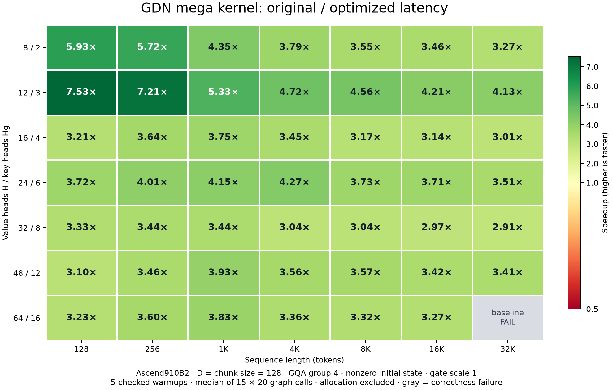

# Current GDN latency heatmap

Snapshot note: this page measures `bfc99e1`. The later `aac5a4d` changes and
checked performance are in the [structural optimization report](optimization_20261026.md).

Updated 2026-10-26. **Original `10748eb` versus current stable `bfc99e1`.** This replaces
the old `5141f56` FP16 heatmap and its outdated 2.91–7.53× summary.



**This is a latency comparison with a historical baseline, not a claim of
accuracy-equivalent implementations.** Current measurements use strict pointwise
and RMSE acceptance. Original timings were collected on 2026-10-23 under the older
RMSE-only policy; fresh original-kernel spot-checks fail the stricter policy.
The figure identifies this distinction explicitly. Missing or failed measurements
remain gray and never receive an inferred speedup.

For a fresh accuracy comparison on this same grid, see the
[maximum absolute error and per-element tolerance heatmaps](error_heatmap.md).
Those plots retain numerical failures and use matched new runs of both kernels.

## Results

Current passes **49/49 shapes** under the strict policy. There are **48 latency ratios**; they range from **1.04× to 3.85×**. For sequences 4K and longer the range is **1.04× to 1.54×**. **0 cells regress below 1×**. The original's failed 64-head/32K cell remains gray.

The neutral point is 1×. Values above 1× mean current is faster; below 1× mean
current is slower. Short-sequence gains can still be larger than long-sequence
gains; the plot shows measured results rather than imposing an expected range.

For H16/Hg4:

| Tokens | Historical original ms | Current stable ms | Original/current |
|---:|---:|---:|---:|
| 128 | 0.106 | 0.069 | 1.52× |
| 256 | 0.145 | 0.094 | 1.55× |
| 1024 | 0.314 | 0.234 | 1.34× |
| 4096 | 0.883 | 0.803 | 1.10× |
| 8192 | 1.727 | 1.574 | 1.10× |
| 16384 | 3.500 | 3.180 | 1.10× |
| 32768 | 6.925 | 6.545 | 1.06× |

These baseline values come from the original head-count sweep. Small differences
from earlier single-head-count tables reflect distinct measurement runs.

- [PNG](heatmap.png) and [SVG](heatmap.svg)
- [Latency/ratio CSV](heatmap.csv) and [full current measurements](heatmap.json)
- [Frozen original measurements](original_heatmap_baseline.json)
- [Original strict spot-check failures](original_heatmap_strict_spotcheck.json)
- [Current algorithm, full test evidence and FLA-specific limitations](current_status.md)

## Workload and checks

Ascend910B2, CANN 9.1.0, torch/torch-npu 2.10.0, NPU 0. H=8/12/16/24/32/48/64,
Hg=H/4, D=chunk size 128, sequence lengths 128/256/1K/4K/8K/16K/32K.
Seed 0, normalized Gaussian Q/K, ordinary log-sigmoid gates (scale 1), and nonzero
initial state. Positive-key FLA cases may use the slower compensated path;
this grid does not characterize those input distributions.

Five checked warmups, then median of 15 trials × 20 graph-replayed calls.
Allocation, CPU reference checks and caller output scaling are outside timing.
The current library hash is verified against the library actually loaded by each
worker. Reuse of original timing records verifies shape/timing settings, software
and hardware environment, and the executable input-generator AST. Only the
input generator's documentation changed since the original measurements.
Initial state uses the same seeded FP16 Gaussian draw multiplied by 0.1.

Every current output/final-state element must satisfy
`abs(error) <= 1e-5 + 1e-3*abs(reference)`, relative RMSE < 0.005, and finiteness,
before and after timing. The sweep reference is CPU FP32 chunked recurrence;
the separate 80-test production suite includes an independent FP64 token oracle.
The cached checker checks every output/state bit on each warmup and replay;
it reuses expensive statistics only for byte-identical validated tensors.
Six targeted tests verify that changed elements, NaNs and different oracle
tensors still force validation. No tolerance was changed.

## Reproduce

The frozen original report is committed; its binary is not needed to refresh
current timings. From the repository root:

```bash
bash scripts/gdn_mega_docker.sh bash scripts/build_gdn_mega.sh
bash scripts/gdn_mega_docker.sh timeout 1800 python benchmarking/gdn_mega_sweep.py \
  --baseline-report docs/gdn_mega/original_heatmap_baseline.json \
  --current-lib build/lib --output docs/gdn_mega/heatmap.json
bash scripts/gdn_mega_docker.sh python benchmarking/plot_gdn_mega.py \
  docs/gdn_mega/heatmap.json
```

The sweep returns exit 1 if any comparison has a failure, including the known
historical baseline failure, while preserving all complete results. Plotting a
complete report with explicitly failed cells is supported. Add `--resume` to reuse
completed head rows only when settings, library hashes, baseline provenance and
checker fingerprints match. The plot rejects incomplete grids, invalid statuses
and inconsistent latency ratios.

To measure both libraries afresh under the current strict policy, use
`--baseline-lib path/to/original/library` instead of`--baseline-report`. That mode
skips timings for failed original cases and does not relabel them as passes.
No kernel implementation, ABI, allocation sizes or numerical tolerance changed
for this heatmap refresh.

## Execution model

The current production kernel still uses one launch and two global phases:
shared gate/Gram preparation, followed by a persistent loop over chunks of each
head. The loop overlaps next-chunk preparation with the current cube work;
state remains FP32 in vector-local storage. Persistence describes the worker's
loop inside a call, not a background process or state retained between calls.
See the [kernel README](../../csrc/kernel/gdn_mega/README.md) for details.

FLOP/s mixes precision and includes transfer/vector/wait time when divided by
full-kernel latency. It is not a pure GEMM throughput measurement. The
[current status report](current_status.md) gives the stable kernel's arithmetic
counts and profiler findings; the old faster, less accurate FP16 figures are
not the current algorithm's performance.
