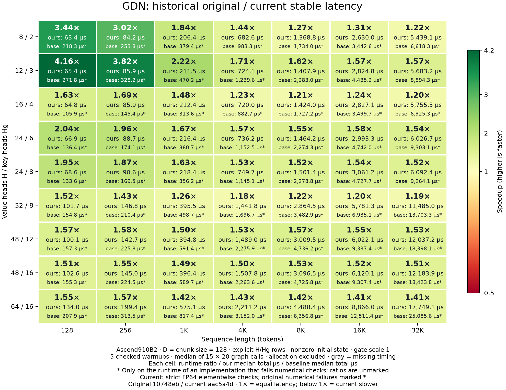

# GDN speedup heatmap

Generated from measurements dated 2026-10-26.
Original **10748eb**, current **aac5a4d**. [Overview](README.md).



Each cell shows three lines: **runtime ratio**, **ours: median total µs**, and
**base: median total µs**. The times cover the full kernel, not an individual
stage; allocation and validation are excluded.
`*` appears only beside a failing implementation's runtime, never on the ratio.
Passing runtimes stay unmarked. See the [matched error report](error_heatmap.md).

Original timings combine frozen historical measurements with fresh timings
for previously missing cells. Original fails strict numerical checks on **63/63 cells**.
Ratios involving a starred runtime are **not accuracy-equivalent speedups**.

Current passes **63/63 shapes**. There are 63 measured runtime
ratios, ranging from **1.18× to 4.16×**.
For 4K and longer, the range is **1.18× to 1.71×**.
There are 0 ratios below 1×. Gray cells mean
that a timing is unavailable, not merely that numerical validation failed.

## Original latency, milliseconds

Columns are token counts. `*` identifies a numerical failure.

| H/Hg | 128 | 256 | 1024 | 4096 | 8192 | 16384 | 32768 |
|---|---:|---:|---:|---:|---:|---:|---:|
| 8/2 | 0.218* | 0.254* | 0.379* | 0.983* | 1.734* | 3.443* | 6.618* |
| 12/3 | 0.272* | 0.328* | 0.470* | 1.240* | 2.283* | 4.435* | 8.894* |
| 16/4 | 0.106* | 0.145* | 0.314* | 0.883* | 1.727* | 3.500* | 6.925* |
| 24/6 | 0.136* | 0.174* | 0.361* | 1.152* | 2.274* | 4.742* | 9.303* |
| 24/8 | 0.134* | 0.169* | 0.356* | 1.145* | 2.279* | 4.728* | 9.264* |
| 32/8 | 0.155* | 0.210* | 0.499* | 1.697* | 3.483* | 6.935* | 13.703* |
| 48/12 | 0.157* | 0.226* | 0.591* | 2.276* | 4.736* | 9.337* | 18.398* |
| 48/16 | 0.155* | 0.224* | 0.590* | 2.264* | 4.726* | 9.307* | 18.424* |
| 64/16 | 0.208* | 0.313* | 0.817* | 3.152* | 6.357* | 12.511* | 25.086* |

## Current latency, milliseconds

Columns are token counts. Current timings remain available even where the original fails.

| H/Hg | 128 | 256 | 1024 | 4096 | 8192 | 16384 | 32768 |
|---|---:|---:|---:|---:|---:|---:|---:|
| 8/2 | 0.063 | 0.084 | 0.206 | 0.683 | 1.369 | 2.630 | 5.439 |
| 12/3 | 0.065 | 0.086 | 0.212 | 0.724 | 1.408 | 2.825 | 5.683 |
| 16/4 | 0.065 | 0.086 | 0.212 | 0.720 | 1.424 | 2.827 | 5.755 |
| 24/6 | 0.067 | 0.089 | 0.216 | 0.736 | 1.464 | 2.993 | 6.027 |
| 24/8 | 0.069 | 0.091 | 0.218 | 0.750 | 1.501 | 3.061 | 6.092 |
| 32/8 | 0.102 | 0.147 | 0.395 | 1.442 | 2.865 | 5.781 | 11.485 |
| 48/12 | 0.100 | 0.143 | 0.395 | 1.489 | 3.010 | 6.022 | 12.037 |
| 48/16 | 0.103 | 0.145 | 0.396 | 1.508 | 3.096 | 6.120 | 12.184 |
| 64/16 | 0.134 | 0.199 | 0.575 | 2.211 | 4.488 | 8.866 | 17.749 |

## Measurement and acceptance

H/Hg=8/2, 12/3, 16/4, 24/6, 24/8, 32/8, 48/12, 48/16, 64/16; D=chunk size 128;
nonzero initial state; seed 0; gate scale1.0.
Normalized Gaussian Q/K and ordinary benchmark inputs; this grid does not cover
all FLA distributions or characterize the slower strong-coupling fallback.

5 checked warmups, median of 15 trials ×
20 graph calls. Allocation and CPU reference work are outside timing.
The loaded library hash is checked for every worker.

The numerical pass criterion for every raw-output and final-state element is
`abs(error) <= 1e-5 + 1e-3*abs(reference)`, plus finiteness and relative RMSE < 0.005,
before and after timing. The baseline is timed even when it fails, with its
failures retained. Current-kernel failures still fail the report command.
Cached statistics are reused only after byte equality
of every output/state element. The current grid uses the independent CPU FP64
token recurrence, computed from the actual rounded inputs. No inverse, decay
threshold or kernel intermediate participates in the oracle. Reference/check
wall times are saved separately from device timings.
See the [matched error heatmaps](error_heatmap.md) for absolute errors and violations.

## Reproduce

```bash
bash scripts/report_gdn_mega.sh latency
# Regenerate Markdown and plots from saved data without an NPU run:
bash scripts/report_gdn_mega.sh render
```

[Measurements and fingerprints](data/heatmap.json) ·
[CSV](data/heatmap.csv) ·
[SVG](figures/heatmap.svg)
