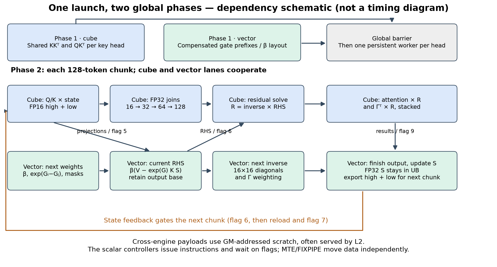
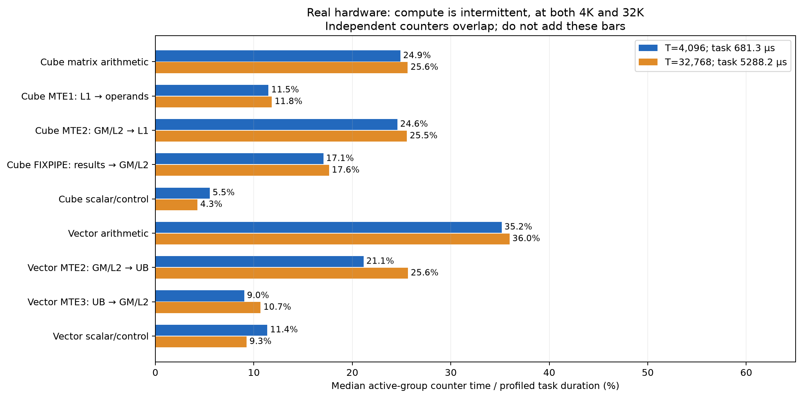
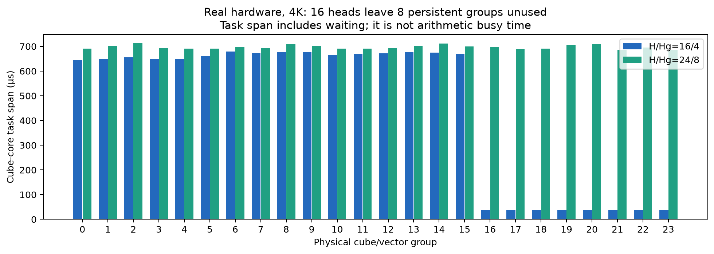
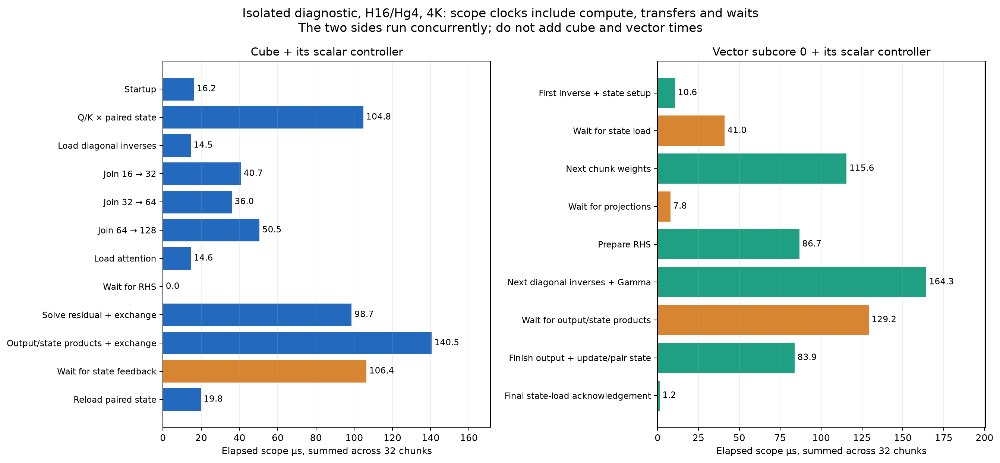
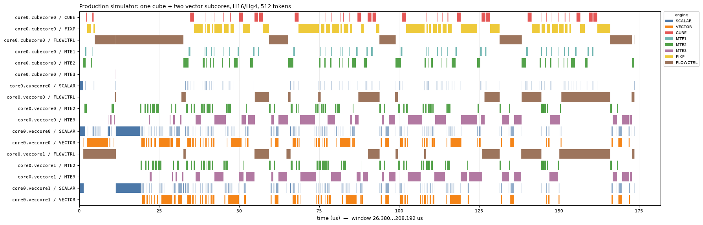
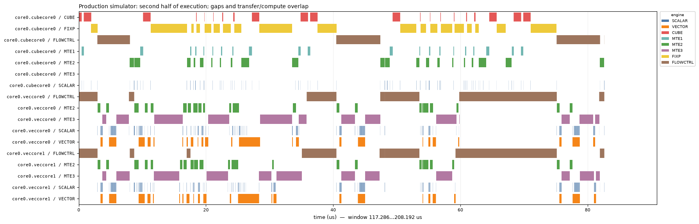
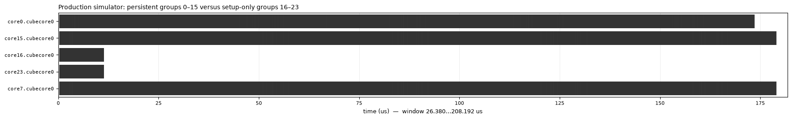

# Current GDN kernel: profile and breakthrough opportunities

Profiled **2026-10-27**, production kernel **677c0ee**, library
`dfb01e1bc24fbcbae52c9f58ca434b539e52635008cf1326160ea28798488ab9` on Ascend 910B2.
This is a measurement and analysis update; no production arithmetic, scheduling,
interface or allocation changed. [Speed heatmap](heatmap.md) · [Accuracy regimes](error_heatmap.md).

**The kernel is limited by its chunk dependency chain and data handoffs, with
additional unused core capacity at small head counts. It is not running anywhere
near continuous cube arithmetic.** At H16/Hg4/T4096, the hardware task takes
**681.30 µs** and the active-group median cube arithmetic time is
**169.46 µs (24.9%)**.
The same pattern persists at 32K. A general 2× gain needs a structural change to
solve/transfer scheduling or the recurrent state dependency; saving a few scalar
instructions or more shared Gram work cannot provide it by itself.

## What was measured

| H/Hg | Tokens | Production graph median µs | Fresh hardware profiler task µs | Persistent groups | Heads per active group |
|---|---:|---:|---:|---:|---:|
| 16/4 | 4,096 | 692.27 | 681.30 | 16/24 | 1 |
| 24/8 | 4,096 | 719.62 | 715.18 | 24/24 | 1 |
| 48/16 | 4,096 | 1422.67 | 1362.44 | 24/24 | 2 |
| 16/4 | 32,768 | 5377.20 | 5288.18 | 16/24 | 1 |

The graph medians are the separately recorded current-kernel heatmap run, with
15 trials × 20 calls. The profiler tasks are fresh `msprof op --aic-metrics=Roofline`
runs on the same production library; profiling replays/counters are not an
additional set of graph medians. Inputs are the ordinary heatmap distribution:
normalized Gaussian Q/K, Gaussian V, uniform β in [0,1), log-sigmoid Gaussian g,
nonzero supplied state, seed 0, D=C=128. This is not a worst-case input audit.
There is no data-dependent fallback in this kernel.

Four production hardware profiles, the 512-token simulator launch, and the
instrumented diagnostic's first/last launches and profiler launch all pass
independent CPU FP64 checks on every output/final-state element:
`abs(error) <= 1e-4 + 1e-3*abs(reference)`, finiteness, and relative RMSE < 0.005.
No tolerances were adjusted. This profiling run does not replace the complete
245-test regression suite previously recorded in [the overview](README.md).

Three evidence sources are kept distinct throughout this report:

- **Hardware counters:** unmodified production binary, real device. Pipe times
  overlap; percentages below use task duration as their denominator.
- **Stage clocks:** a separately compiled diagnostic copy with `get_sys_cnt()`.
  It has 3 warmups and 15 samples; tables use per-core sample medians, then the
  median over groups 0–15. Clock frequency is 50,003,000 Hz, queried from HAL.
  The instrumented profiler task is 686.14 µs
  (+0.7% versus production), so stage attribution is approximate.
  Single-launch event median 730.54 µs also includes submission/event
  effects and is not substituted for graph latency. Scope clocks include
  transfers, instruction issue and waits. Medians do not add exactly.
- **Traceviz timeline:** unmodified production binary in the simulator,
  **512 tokens / four chunks**, 1,205,863 events,
  span 181.81 µs. It explains ordering and overlap,
  not the absolute latency or critical-path proportions of the 4K hardware run.

## Hardware vocabulary and the two global phases

There are **24 hardware groups**, each with one cube core and two vector
subcores. Both core types have scalar control/instruction machinery. “SCALAR”
in a trace is that core's controller, not a third pool of independent workers.

| Lane / memory | Role in this kernel |
|---|---|
| CUBE | Matrix multiply/accumulate. FP16 inputs with FP32 accumulation for grams/projections; native FP32 operands for joins, residual and output/state products. |
| VECTOR | Gate weighting, masks, 16×16 diagonal substitution, RHS subtraction, output addition, authoritative FP32 state update and high/low encoding. |
| SCALAR | Loop/index/address work, tile setup, instruction issue and synchronization control. Scalar busy time is distinct from time waiting on flags. |
| FLOWCTRL | Simulator control-flow lane; includes `WAIT_FLAG_DEVI` as well as branching. A busy control lane can mean waiting, not useful math. |
| MTE1 | Move operands from L1 into cube operand buffers L0A/L0B. |
| MTE2 | Load GM-addressed data into L1 (cube) or UB (vector); L2 often serves these requests. |
| MTE3 | Export vector UB results to GM-addressed scratch/output. |
| FIXP / FIXPIPE | Export cube accumulator L0C results, including FP32 scratch stores. |
| L1 / UB | Cube-local operand storage / vector-local storage. The authoritative FP32 state stays in vector UB across chunks. |



**Phase 1:** gate scan/layout and shared KKᵀ/QKᵀ execute concurrently, then a
global barrier joins them. **Phase 2:** persistent head workers loop over
128-token chunks, retaining state locally. Suboperations in the diagram are
not separate launches or new global stages. The diagnostic's median cube-side
phase clocks are 22.37 µs for setup and 641.74 µs for the persistent phase.

The inverse still has a full **128×128** domain. Vector solves eight 16×16
diagonal blocks; cube joins them at widths 16, 32 and 64 to obtain the full
inverse. There is no power-series truncation or repeated squaring. The
16×16 dimension is an internal solve tile, not a smaller token chunk.
The diagram's “next inverse” belongs to chunk t+1; the cube joins consume the
inverse blocks prepared for chunk t. Flag 5 acknowledges that the cube has
loaded the current blocks, allowing the vector side to reuse their scratch.

## What the hardware is actually busy doing



At H16/T4096, active-group median cube MTE2 time is
167.42 µs and FIXPIPE time is
116.20 µs. Vector arithmetic takes
239.54 µs; vector MTE2 takes
144.00 µs. These are overlapping engine
counters, not a partition of the kernel duration.

Cube-side L2 read-hit rate is 98.97%
and vector-side rate is 97.66%
(active-group medians). GM→L1 traffic is 16.16 MiB
per active cube group, and L0C→GM is 12.44 MiB.
**GM-addressed traffic is not equivalent to HBM traffic.** These results support
transfer/dependency latency as a target; they do not prove that memory bandwidth
is saturated or that eliminating every byte saves its full counter time.



With 16 heads, only 16/24 groups execute the persistent recurrence. With 24
heads all groups work; 48 heads run two heads per group. The near-doubling from
24 to 48 heads shows the cost of the additional head wave. Occupancy is therefore
a real opportunity for small H, but it cannot explain all inefficiency: 24 and
48 heads also leave large gaps between cube arithmetic operations.

## Where time goes inside the persistent loop



Cube-side diagnostic, H16/Hg4/T4096, 32 chunks per head. The final column
amortizes startup across those 32 chunks; it is not a claim that startup repeats.

| Cube scope | Per-head total µs | Amortized µs/chunk |
|---|---:|---:|
| Startup | 16.25 | 0.51 |
| Q/K × paired state | 104.76 | 3.27 |
| Load diagonal inverses | 14.53 | 0.45 |
| Join 16 → 32 | 40.70 | 1.27 |
| Join 32 → 64 | 36.01 | 1.13 |
| Join 64 → 128 | 50.48 | 1.58 |
| Load attention | 14.61 | 0.46 |
| Wait for RHS | 0.02 | 0.00 |
| Solve residual + exchange | 98.68 | 3.08 |
| Output/state products + exchange | 140.48 | 4.39 |
| Wait for state feedback | 106.41 | 3.33 |
| Reload paired state | 19.76 | 0.62 |

| Vector subcore 0 scope | Per-head total µs |
|---|---:|
| First inverse + state setup | 10.65 |
| Wait for state load | 40.96 |
| Next chunk weights | 115.58 |
| Wait for projections | 7.82 |
| Prepare RHS | 86.73 |
| Next diagonal inverses + Gamma | 164.32 |
| Wait for output/state products | 129.18 |
| Finish output + update/pair state | 83.86 |
| Final state-load acknowledgement | 1.24 |

The two vector subcores have the same responsibilities on different row halves;
all their samples are retained in the data. Their streams and the cube stream
run concurrently. **Do not add these two tables to estimate kernel time.**

Three consequences matter:

1. **The earlier RHS dependency is already hidden.** Its cube wait is only
   0.02 µs over 32 chunks. Vector can form RHS while cube assembles the
   inverse. Optimizing that wait alone has essentially no available gain.
2. **The later state-feedback dependency is still exposed.** Cube waits
   106.41 µs, then spends 19.76 µs reloading the paired state.
   Vector finalization itself takes 83.86 µs and includes output work
   before state update. Some next-chunk preparation also sits before that update.
   Which part can be hidden requires a changed schedule, not simply removing waits.
3. **Preparation and inverse transfers are substantial.** Vector next-chunk
   weighting plus diagonal/Gamma preparation totals 279.90 µs, overlapping
   cube work. Cube joins alone total 127.18 µs despite having little arithmetic.
   The final 64→128 join takes 50.48 µs; optimizing just that join cannot
   recover the entire inverse/feedback cost.

## Why the matrix-heavy parts have low effective TFLOPS

The following counts come from actual dense matrix dimensions, counting multiply
plus add as two FLOPs. They include both FP16 state components and all executed
full tiles, exclude vector operations, and do not use the profiler's
instruction-derived `aic_cube_fops` field as a general mixed-precision FLOP count.
Each row's FLOPs cover **all heads**, while its time is the representative elapsed
scope of those concurrently executing heads. These are effective device
throughputs **including transfers/waits**, not isolated arithmetic peak rates.
The shared-Gram time includes gate-scan overlap and the setup barrier.

| Work at H16/Hg4/T4096 | Matrix GFLOPs | Diagnostic elapsed µs | Effective TFLOP/s | Operand precision |
|---|---:|---:|---:|---|
| Shared KKᵀ + QKᵀ | 1.074 | 22.37 | 48.00 | FP16 → FP32 |
| Q/K × paired state | 8.590 | 104.76 | 81.99 | FP16 high + low → FP32 |
| Inverse joins | 0.705 | 127.18 | 5.54 | FP32 |
| Apply inverse to RHS | 2.147 | 98.68 | 21.76 | FP32 |
| Attention and state products | 4.295 | 140.48 | 30.57 | FP32 |

Inverse joins are only about **4.5% of persistent matrix FLOPs**, yet occupy a
large elapsed scope. Each level executes two dependent products, exporting the
first result and reloading it before the second. Across levels there are
**six synchronized export/reload phases per chunk**, containing **14 matrix
product results** (four pairs at 16, two at 32, one at 64). Independent pairs
are already batched; the serial per-pair version is not the current algorithm.

The hardware's direct accumulator-to-L1 path narrows these results to FP16/BF16,
so retaining native FP32 currently takes a GM/L2 round trip. Small 16/32 products,
operand setup, synchronization, and those round trips dominate their low effective
TFLOPS. FP16 and FP32 arithmetic also have different throughput: their TFLOPS
should not be compared as if they had the same hardware ceiling.

L1 allocation reaches its 512 KiB boundary in the current schedule (the last
64 KiB holds residuals). Some allocations reuse earlier lifetimes. A proposed
extra buffer must fit those lifetimes; “double-buffer everything” is not feasible.

## Traceviz: see the gaps and the handoffs



This is one physical group: one cube core and both vector subcores. Read CUBE
and VECTOR as arithmetic, MTE/FIXP as data movement, and SCALAR/FLOWCTRL as the
controllers issuing and waiting for work. White regions mean no events on that
lane; they do not by themselves identify which dependency caused the gap.
Traceviz's aggregate occupancy includes wait instructions: a nearly full
aggregate lane does not mean the arithmetic units are nearly fully utilized.



In the **second half of this simulator trace**, traceviz measures overlap on the
same core, never by matching one core's stores against another core's computation:

| Movement pipe versus arithmetic | Movement time overlapped with arithmetic | Median exposed movement µs/core |
|---|---:|---:|
| FIXP against CUBE | 0.0% | 34.75 |
| MTE2 against CUBE | 0.0% | 12.02 |
| MTE3 against VECTOR | 0.0% | 27.82 |

“Exposed” is relative to the named arithmetic pipe only. It is not an additive
critical-path budget or a promised speedup; other work can overlap that movement.
The simulator has different absolute timing from hardware. Its ordering evidence
supports, but does not replace, the real-device stage/counter measurements.



The compact trace confirms that groups 16–23 stop after setup for H16. The
hardware group-span chart above establishes the same behavior on the real device.

## Ranked opportunities for larger gains

These are hypotheses to test, not implemented speedups. The constraints are the
approved elementwise budget, all 160 numerical regimes in ordinary pytest, and
reasonable gate/correlated-key performance without a sequential fallback.

| Priority | Structural experiment | Evidence / possible benefit | Main tradeoff and decisive test |
|---|---|---|---|
| 1 | **Shorten the state feedback path.** Publish updated state before output finalization; reorganize output work and paired-state transfer so next projections can begin earlier. | About 106 µs of cube feedback wait plus 20 µs reload per 4K head. Vector currently finishes output before updating state. | Output base and pending inverse coefficients share UB lifetimes. Reordering alone may fail if it displaces other preparation. Measure feedback wait and whole-kernel latency together; preserve FP32 state. |
| 2 | **Avoid materializing the full inverse.** Apply a blocked triangular solve directly to RHS, keeping solved residual panels local and batching updates. | Could remove inverse join materialization and reduce dense inverse/application arithmetic. A straightforward 16-row block solve needs about 2.36M matrix FLOPs/chunk versus 5.57M for joins plus dense inverse application. | Eight dependent block steps and smaller matmuls can be slower despite fewer FLOPs. A previous partial factored-64 experiment was slower; a new version must remove transfers, not merely rearrange products. Test persistent reuse and transfer count before broad tuning. |
| 3 | **Use bounded helper workers for state-independent preparation.** Let otherwise idle groups prepare future weighted coefficients/inverses while head workers advance states. | H16 leaves eight groups unused; next-chunk vector preparation and inverse joins are substantial. | Requires bounded buffering, explicit producer/consumer ownership and enough helper throughput. Earlier full precomputation was slower, so avoid repeating a global materialize-and-barrier design. Benefits may vanish at H24/H48; verify those shapes too. |
| 4 | **Parallelize the chunk-state recurrence with affine composition.** Express each chunk as S_out = M_chunk S_in + B_chunk, then scan chunk transforms. | Removes the long per-head serial chain and exposes sequence parallelism when head count is small. This is the broadest algorithmic route to a larger gain. | More 128×128 products, scratch and communication; long products introduce their own rounding concerns. Prototype only with explicit work/traffic accounting and long-context FP64 checks. No speedup is established. |

Simple head/value-column sharding is not automatically a win: splitting 16
heads into two workers each creates 32 workers on 24 groups, hence two waves,
while duplicating some solve work and shrinking GEMMs. It needs an actual
balanced schedule and reuse plan. Likewise, using cubes for the 16×16 leaf solve
only helps if stable arithmetic and operand-transfer cost beat the current
vector substitution; returning to huge cancelling inverse powers is not a safe
substitute.

The setup clock is only about 3.4% of the diagnostic's
setup-plus-persistent time. Even deleting all setup has an optimistic Amdahl
ceiling of roughly 1.03×. Deleting the measured feedback
wait alone would have an optimistic ceiling of roughly
1.19×. These are illustrative limits under
fixed other costs, **not predictions**. A genuine 2× requires reducing multiple
dependencies or changing the recurrence/solve structure.

## Reproduce and inspect the evidence

```bash
# Fresh hardware profiles, production simulator trace, isolated diagnostic,
# then figures and Markdown. NPU runs are serialized.
bash scripts/profile_gdn_mega.sh collect

# Regenerate figures/report from this run's saved raw profiles:
bash scripts/profile_gdn_mega.sh render benchmark_data/gdn_mega/profile_current_20261027
```

The script uses the local `../traceviz-mcp` library (commit
`22664d1a3a7c2ac3708d28a301605716b8b3725b`) for parsing, overlap analysis and timeline rendering.
Its loader converts Chrome trace timestamps from microseconds to nanoseconds;
the JSON `displayTimeUnit` hint does not change the underlying timestamp unit.

- [Raw hardware tables, all clock samples, numerical checks and fingerprints](data/profile.json)
- [Traceviz summary and overlap calculations](data/profile_traceviz.txt)
- Vector figures: [pipeline](figures/profile_pipeline.svg), [hardware counters](figures/profile_hardware.svg), [groups](figures/profile_groups.svg), [stage scopes](figures/profile_stages.svg)
- [Reproduction script](../../scripts/profile_gdn_mega.sh)
- [Diagnostic generation, measurement, figures and report code](../../benchmarking/profile_gdn_mega.py)

Large raw profiler dumps remain in `benchmark_data/gdn_mega/profile_current_20261027` (ignored), including
the simulator trace and measurement inputs needed to render the report.
Diagnostic sources/libraries are disposable and can be regenerated by the
collection script. Committed evidence retains all hardware CSV contents, diagnostic samples and hashes; the trace hash
identifies the local raw input used for the figures. Recollection requires the
NPU/CANN environment and sibling traceviz checkout. Rendering requires the saved
raw directory and plotting dependencies. No diagnostic code or macros were
added to the production kernel.
