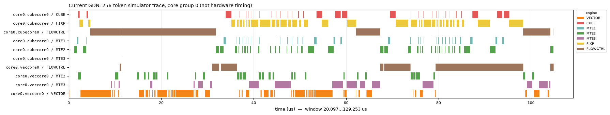

# Why the stable GDN kernel is only about 10% faster

Measured 2026-10-26 on Ascend910B2, H16/Hg4, T4096, D128, ordinary Gaussian
inputs and nonzero initial state. Original `10748eb`, current `bfc99e1`.

**Sharing KKᵀ/QKᵀ remains effective, but that work is now a small part of total
runtime. The numerically stable recurrent pipeline spends much of its time on
vector preparation, small dependent inverse products, transfers and state
feedback. It also uses only 16 of 24 cube groups at this head count.**

## Fresh production hardware profiles

| Measurement | Original | Current |
|---|---:|---:|
| Whole-kernel device duration | 0.8903 ms | 0.7944 ms |
| Cube arithmetic active time | 220.45 µs | 175.58 µs |
| Cube arithmetic activity / task duration | 24.8% | 22.1% |
| Vector arithmetic active time, vector subblock 0 | 165.33 µs | 316.97 µs |
| Cube input DMA active time, MTE2 | 137.97 µs | 193.66 µs |
| Cube result export active time, FIXPIPE | 123.76 µs | 148.04 µs |
| Cube input DMA instruction count | 377.5 | 846 |
| Cube GM→L1 traffic, profiler KB | 11,969 | 16,544 |
| Cube L0C→GM traffic, profiler KB | 7,216 | 12,736 |
| Cube L0C→L1 traffic, profiler KB | 9,216 | 0 |

These are fresh hardware `msprof op` results. Except whole-kernel duration,
entries are medians over physical groups 0–15, the groups active in the current
head-persistent recurrence. Fractional counts are medians, not fractional
instructions. **The counters overlap and cannot be summed into elapsed time.**
The profiler collects metric groups through replay; it is separate from the
graph benchmark used in the latency heatmap.

This run shows **1.121× speedup, or 10.8% lower latency**, consistent with the
previous graph comparison of 0.8827→0.8027 ms (1.100×). The original still fails
strict numerical acceptance; this is not an accuracy-equivalent comparison.

The reduction from roughly 68.92 to 16.81 executed matrix GFLOPs does not imply
a proportional latency reduction. The current implementation replaces much of
the original dense FP16 inverse arithmetic with vector solves and small FP32
products whose transfers and dependencies dominate their useful arithmetic.
Only the raw Gram products can be shared; head-specific decay/beta weighting,
inverses, residuals and state updates remain. The earlier approximately 0.25 ms
FP16 implementation failed strict numerical checks and is not a valid stable
performance target already achieved by this branch.

## Where the current time goes

Separate diagnostic copies of both kernels were instrumented with device clock
reads. Production files and binaries were not modified. Three warmups and 15
measurements were used; the clock frequency was queried from the driver.

| Current global phase | Device time |
|---|---:|
| Shared KKᵀ/QKᵀ plus concurrent gate preparation and global synchronization | 34.20 µs |
| Head-persistent recurrence | 768.41 µs |

Phase values are the maximum across per-core medians. Diagnostic instrumentation
changes timing slightly; these are not substitutions for production latency.
Even removing the entire first phase would save only approximately 4% of the
current runtime. The 75% reduction in raw Gram matrix work is already included.

The recurrent cube lane contains these timed sections, summed over its 32 chunks:

| Cube section | Median per active core |
|---|---:|
| Q/K loads, two-component state projections and projection exports | 100.27 µs |
| Inverse loads and FP32 block joins | 223.60 µs |
| Attention loads | 22.71 µs |
| Wait for RHS | 0.02 µs |
| RHS load, solve and residual export/reload | 97.94 µs |
| Weighted K loads, output/state products and exports | 143.75 µs |
| Wait for updated state | 129.00 µs |
| Reload paired state | 19.05 µs |

These sections include their data movement and synchronization. They are not
standalone GEMM latencies. Their independently computed medians need not sum
exactly to the phase maximum. Other loop/startup/control costs are not assigned
to these sections.

The vector lane's inverse/preparation routine takes about **436 µs** per head:

| Preparation substep, vector subblock 0 | Median per active core |
|---|---:|
| Gram loads, decay weighting, masking and coupling checks | 214.04 µs |
| Stable 16×16 diagonal triangular solves | 162.49 µs |
| Inverse export, weighted K preparation/export and control marker | 56.21 µs |

The second vector subblock gives similar values: 216.32/161.31/58.03 µs.
The vector lane also spends about 74 µs preparing the RHS and 74 µs finishing
outputs/updating and splitting state. **Vector and cube measurements overlap;
adding the two tables would double-count time.** No strong-coupling fallback
was taken: every active lane processed all 32 ordinary chunks.

For comparison, fresh original diagnostic phase times are:

| Original phase | Maximum of per-core medians |
|---|---:|
| Gate scan | 21.42 µs |
| Transposes | 7.48 µs |
| KKᵀ | 113.73 µs |
| Inverse | 283.44 µs |
| Additional barrier | 2.38 µs |
| WY | 76.00 µs |
| State update | 220.21 µs |
| Output including QKᵀ | 166.41 µs |

Current phases fuse and overlap these operations, so individual original/current
rows are not interchangeable. In particular, original KKᵀ excludes QKᵀ, while
current shared preparation includes both.

## Why the matrix engines have low effective throughput

1. **Small dependent inverse joins repeatedly leave the matrix engine.**
   `mega_float_inverse` performs seven block joins per chunk. Each join has two
   matrix multiplications, each followed by an FP32 store to GM scratch and a
   reload before its dependent consumer. That is 14 scratch round trips per
   head/chunk, or 7,168 over this shape. This implementation chooses that path;
   the profile does not establish a hardware requirement to do so. L2 caching
   can service GM traffic, so this is not a claim that every transfer reaches HBM.
   The device counters confirm more GM traffic and no direct L0C→L1 traffic in
   the current kernel, despite far fewer matrix FLOPs.
2. **Preparation delays state feedback.** The vector lane prepares the next
   inverse before finishing the current output/state update. Its roughly
   436 µs preparation stream does not fit entirely behind the available cube
   work; the cube's measured wait for updated state is about 129 µs. The nearly
   zero RHS wait shows that the late state feedback is a different dependency.
3. **One persistent worker per head leaves capacity unused.** With 16 value
   heads, groups 16–23 finish after setup while groups 0–15 run the recurrence.
   The hardware profile records only about 35–38 µs of activity for those idle
   groups versus roughly 779 µs for active groups. This is a scheduling limit,
   not evidence that the chip has reached its matrix throughput ceiling.

These measurements support latency and dependency bottlenecks rather than a
simple shortage of FLOPs or bulk bandwidth. They do not prove a particular
replacement schedule will be faster.

## Timeline evidence and next optimization targets



This is a **256-token simulator** trace rendered with `../traceviz-mcp`; it is
not the 4K hardware run. In the selected cube lane, FIXPIPE and cube arithmetic
have 0% overlap. The repeated exports and loads are visible between small
arithmetic bursts. Simulator timings differ from hardware, particularly startup
waits; the quantitative 4K conclusions above come from hardware measurements.

The strongest next targets are reducing scratch round trips in the stable
inverse/solve, and moving independent preparation off the state-feedback path
while making use of idle core groups. Earlier full precomputation was slower,
so this would need a different schedule with bounded intermediate storage and
measured transfer costs. Merely removing more shared Gram work cannot produce
a large overall improvement. Changing paired projections to native FP32 is a
worthwhile controlled experiment, but the entire projection section is only
about 100 µs; it cannot explain or recover the whole missing speedup by itself.

## Evidence and reproduction

- [Raw hardware CSV tables and aggregated counters](profile_comparison.json)
- [Device clock samples, accuracy checks, source hashes and measurement script](profile_phase_timings.json)
- [Numerical results from the production hardware profiles](profile_accuracy.json)
- [Exact diagnostic source patch](profile_diagnostic.patch)
- [Traceviz summary and overlap report](profile_traceviz.txt)
- [Validation and provenance](profile_validation.txt)

Inside the prepared CANN container, source `set_env.sh`, then run:

```bash
msprof op --kernel-name='*gdn_mega*' \
  --aic-metrics=PipeUtilization,ArithmeticUtilization,Memory,MemoryL0,MemoryUB,L2Cache,ResourceConflictRatio \
  --output=benchmark_data/gdn_mega/profile_current_recheck \
  python benchmarking/gdn_mega.py --heads 16 --key-heads 4 --lengths 4096 \
    --initial-state --profile-once --output benchmark_data/gdn_mega/profile_current_recheck_accuracy.json
```

For the original, prepend the frozen `benchmark_data/gdn_mega/baseline_lib`
directory to `LD_LIBRARY_PATH` and use a different output directory. Retain its
reported accuracy failure; profiling it does not turn that failure into a pass.
For the simulator, prepend `$ASCEND_HOME_PATH/tools/simulator/Ascend910B2/lib`,
use `msprof op simulator --aic-metrics=PipeUtilization`, and change length to 256.

For diagnostic phases, create `current/` and `original/` source copies from the
recorded commits, apply the saved patch, and compile each isolated library with
the recorded `build_flags` and `bisheng`. Link with
`-shared -s -Wl,-z,relro -Wl,-z,now -Wl,-soname,libno_workspace_kernel.so`.
The exact measurement script is stored in `profile_phase_timings.json` under
`measurement_script`; run it from the repository root with the appropriate
library directory prepended to `LD_LIBRARY_PATH`. Its local output directory is
`benchmark_data/gdn_mega/profile_diagnostic_20261026/`.
